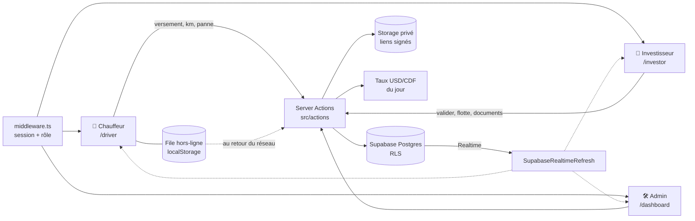
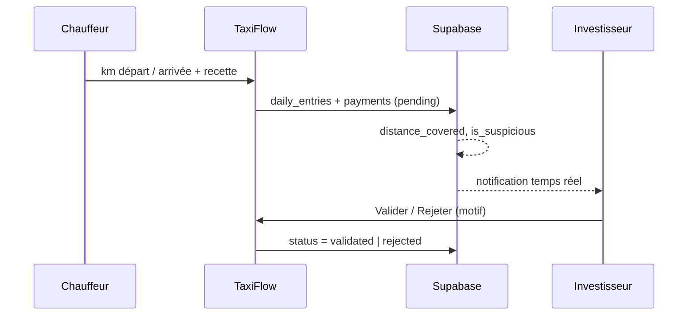

# TaxiFlow RDC

[](https://github.com/Menace2societe/TaxiFlow-RDC/actions/workflows/ci.yml)


Gestion de flotte de **taxis et motos-taxis** pour la République démocratique du Congo.
Les **investisseurs** suivent leurs véhicules et leurs recettes, les **chauffeurs** déclarent leurs
versements depuis le terrain (même sans réseau), et chaque déclaration est contrôlée par le
**kilométrage** pour repérer les recettes sous-déclarées.

Pensé pour Kinshasa : montants en **francs congolais (CDF)** avec le taux USD du jour, heure de
Kinshasa (ou Lubumbashi), numéros **+243**, chauffeurs sans email, interface en français et thème
sombre lisible en plein soleil.

---

## Fonctionnalités

- **Trois espaces, un seul login** : administrateur, investisseur, chauffeur. Le middleware redirige
  chacun vers son tableau de bord selon son rôle.
- **Versements journaliers** : le chauffeur déclare sa recette, l'investisseur **valide ou rejette**
  (motif obligatoire). Les paiements en espèces peuvent être saisis à la main par l'investisseur.
- **Anti-fraude kilométrique** : km de départ / d'arrivée, distance calculée par la base, et entrée
  marquée **suspecte** quand la distance dépasse 50 km pour une recette ≤ 5 000 CDF (montant converti
  en CDF : un versement en USD n'est pas pénalisé). Les alertes s'affichent dans un panneau dédié
  côté investisseur et admin.
- **Application installable (PWA)** : s'ajoute à l'écran d'accueil comme une vraie app. Les pages
  déjà ouvertes s'affichent sans réseau, et les versements (photo comprise) sont gardés sur le téléphone
  puis envoyés au retour de la connexion.
- **Paiement Mobile Money** : le chauffeur paie son versement par **M-Pesa, Airtel Money ou Orange
  Money** (via pawaPay). Le versement est validé automatiquement dès que l'argent est reçu.
- **Photo du compteur** jointe à chaque versement, et écran **Contrôle & alertes** : l'investisseur
  examine les recettes suspectes photo à l'appui et les marque « justifiée » ou « fraude ».
- **Courses hors application détectées** : si le compteur avance entre deux journées déclarées, les
  kilomètres non déclarés sont signalés ; un compteur qui recule aussi. Les jours sans recette d'un
  véhicule en service sont listés.
- **Dépenses et bénéfice net** par véhicule et par mois (carburant, entretien, réparations, assurance…).
- **Contrats chauffeurs** : employé ou **location-vente**, avec l'avancement du rachat calculé à partir
  des versements validés et une date de fin estimée.
- **Échéances des documents** : date d'expiration de l'assurance, du contrôle technique, du permis… avec
  alertes à 30 jours, 7 jours et le jour J.
- **Alertes WhatsApp** : chaque matin, un message récapitulatif à l'investisseur (documents qui
  expirent, recettes suspectes, km non déclarés), jamais deux fois la même alerte.
- **Connexion par SMS ou WhatsApp** : le chauffeur reçoit un code à usage unique sur son numéro +243.
- **Chauffeurs sans email** : l'investisseur inscrit un chauffeur avec son numéro ; l'app génère un
  **code d'accès** à lui transmettre. Le chauffeur se connecte avec « numéro + code », sans SMS payant,
  puis peut choisir son propre code.
- **Pannes et maintenance** : déclaration de panne → réparation en cours → résolue, et le statut
  du véhicule suit (`en service`, `maintenance`, `repos`).
- **Flotte investisseur** : ajout de véhicules (taxi / moto), affectation d'un chauffeur par son
  numéro, recette du mois par véhicule.
- **Chauffeur-propriétaire** : un chauffeur peut enregistrer son propre véhicule ; ses versements sont
  validés automatiquement.
- **Documents légaux** : carte rose, assurance, permis, contrats… dans un bucket **privé**, ouverts par
  des liens signés valables 1 h, uniquement par l'investisseur et le chauffeur concernés.
- **Taux USD/CDF du jour** : mis à jour automatiquement (cache 6 h), affiché dans les formulaires.
- **Heure locale** : toutes les dates « du jour » suivent le fuseau de la flotte, pas l'UTC.
- **Export CSV** : recettes et versements, prêts pour Excel en français.
- **Tableaux de bord** : KPIs, recettes par semaine, mix taxi / moto, meilleur chauffeur (Recharts).
- **Temps réel** : les pages se rafraîchissent quand un versement, une panne ou un véhicule change.
- **Sécurité en base** : rôle figé à l'inscription, versements « en attente » sauf chauffeur-patron,
  numéros visibles seulement par les personnes liées. C'est garanti par la RLS Postgres, pas seulement
  par l'interface, et vérifié par les tests.

## Architecture



## Parcours d'un versement



## Stack

| Couche | Choix |
|---|---|
| Front + back | **Next.js 14** (App Router, Server Components, Server Actions), React 18 |
| Langage | TypeScript strict, validation **zod** |
| Base de données | **Supabase** : Postgres, Row Level Security, Auth, Storage, Realtime |
| UI | Tailwind CSS 3, lucide-react, Recharts |
| Dates | date-fns + date-fns-tz (`Africa/Kinshasa`, `Africa/Lubumbashi`) |
| Tests | Vitest + [PGlite](https://pglite.dev) (Postgres embarqué, sans Docker) |
| Hébergement | Vercel |

## Démarrage rapide

**Prérequis** : Node.js 20+, un projet [Supabase](https://supabase.com) (gratuit), et la
[CLI Supabase](https://supabase.com/docs/guides/cli) pour les migrations.

```bash
git clone https://github.com/Menace2societe/TaxiFlow-RDC.git
cd TaxiFlow-RDC
npm install
cp .env.example .env.local      # puis remplir les valeurs
supabase link --project-ref <votre-ref>
supabase db push                # applique supabase/migrations
npm test                        # tests unitaires + migrations
npm run dev                     # http://localhost:3000
```

Créez ensuite un compte sur `/register` (investisseur ou chauffeur).

### Nommer un administrateur

L'inscription publique ne crée que des chauffeurs et des investisseurs.

**Le premier admin** se nomme une seule fois dans **Supabase → SQL Editor** :

```sql
update public.profiles set role = 'admin'
where id = (select id from auth.users where email = 'vous@exemple.com');
```

**Les suivants** se nomment depuis l'application : `/dashboard/users`, choisir le rôle, *Appliquer*.
Un admin ne peut pas changer son propre rôle, il reste donc toujours au moins un administrateur.

## Configuration (`.env.local`)

| Variable | Où la trouver | Rôle |
|---|---|---|
| `NEXT_PUBLIC_SUPABASE_URL` | Supabase → Project Settings → API | URL du projet (**obligatoire**) |
| `NEXT_PUBLIC_SUPABASE_ANON_KEY` | Supabase → Project Settings → API | Clé publique, soumise à la RLS (**obligatoire**) |
| `SUPABASE_SERVICE_ROLE_KEY` | Supabase → Project Settings → API | **Serveur uniquement** : création des comptes chauffeurs par téléphone et de leurs codes d'accès. Ne jamais l'exposer côté client ni la préfixer `NEXT_PUBLIC_`. |
| `NEXT_PUBLIC_APP_TIMEZONE` | *(optionnel)* | `Africa/Kinshasa` (défaut, UTC+1) ou `Africa/Lubumbashi` (UTC+2) |
| `USD_CDF_FALLBACK_RATE` | *(optionnel)* | Taux utilisé si l'API de change ne répond pas (défaut `2800`) |
| `DRIVER_LOGIN_EMAIL_DOMAIN` | *(optionnel)* | Domaine des identifiants techniques des chauffeurs (défaut `chauffeurs.taxiflow.invalid`, jamais utilisé pour envoyer un email) |
| `PAWAPAY_API_TOKEN` / `PAWAPAY_ENV` | [Tableau de bord pawaPay](https://dashboard.pawapay.io) | Active le paiement Mobile Money. `sandbox` pour tester, `live` en production |
| `NEXT_PUBLIC_SMS_LOGIN_ENABLED` | *(optionnel)* | `true` affiche la connexion par SMS / WhatsApp (après configuration dans Supabase) |
| `WHATSAPP_TOKEN` / `WHATSAPP_PHONE_NUMBER_ID` | Meta → WhatsApp → API Setup | Alertes WhatsApp quotidiennes |
| `WHATSAPP_TEMPLATE` / `WHATSAPP_TEMPLATE_LANG` | *(optionnel)* | Modèle de message approuvé (défaut `taxiflow_alerte`, `fr`) |
| `CRON_SECRET` | une longue chaîne aléatoire | Protège la tâche quotidienne d'alertes (Vercel l'envoie automatiquement) |
| `NEXT_PUBLIC_SITE_URL` | *(optionnel)* | URL du site dans les messages WhatsApp (détectée sur Vercel) |

### Activer les services externes

Chaque service est optionnel : sans configuration, la fonctionnalité reste masquée ou désactivée
proprement, et le reste de l'application fonctionne.

**Mobile Money (pawaPay)**
1. Créez un compte marchand sur [pawaPay](https://pawapay.io). Il couvre M-Pesa, Airtel Money et
   Orange Money en RDC avec un seul contrat.
2. Copiez le jeton API dans `PAWAPAY_API_TOKEN` (commencez avec `PAWAPAY_ENV=sandbox`).
3. Dans le tableau de bord pawaPay, réglez l'URL de callback des dépôts sur
   `https://<votre-domaine>/api/mobile-money/callback`. Le statut est toujours revérifié auprès de
   pawaPay : un faux callback ne peut pas valider un versement.

**Connexion par SMS / WhatsApp**
1. Supabase → Authentication → Sign In / Providers → **Phone** : activez-le et choisissez un fournisseur
   (Twilio couvre la RDC et propose aussi WhatsApp). Pour un fournisseur local, utilisez le
   [Send SMS hook](https://supabase.com/docs/guides/auth/auth-hooks/send-sms-hook).
2. Mettez `NEXT_PUBLIC_SMS_LOGIN_ENABLED=true` : le lien apparaît sur la page de connexion.
   Seuls les numéros déjà inscrits reçoivent un code, cette page ne crée aucun compte.

**Alertes WhatsApp**
1. Créez une app WhatsApp Business sur [Meta for Developers](https://developers.facebook.com) et
   récupérez le jeton permanent et l'identifiant du numéro.
2. Faites approuver un modèle nommé `taxiflow_alerte`, langue français, catégorie *Utility*, avec le
   corps `Alerte TaxiFlow : {{1}}`.
3. Renseignez `WHATSAPP_*` et `CRON_SECRET` sur Vercel. La tâche tourne chaque jour à 7 h (heure de
   Kinshasa) et écrit dans `notification_log`. Le numéro de l'investisseur est celui de son profil.

Sur Vercel, ajoutez les mêmes variables dans *Project → Settings → Environment Variables*.

## Rôles et espaces

| Rôle | Accueil | Ce qu'il peut faire |
|---|---|---|
| **Chauffeur** | `/driver/portal` | Déclarer ses versements et ses km, signaler une panne, voir son contrat et ses documents, changer son code |
| **Chauffeur-propriétaire** | `/driver/portal` | Tout ce qui précède + enregistrer son véhicule et ses documents ; versements validés d'office |
| **Investisseur** | `/investor/dashboard` | Flotte, recrutement des chauffeurs et codes d'accès, validation des versements, recettes, alertes km, maintenance, documents, exports CSV |
| **Admin** | `/dashboard/overview` | Saisie journalière, flotte, rapports et export CSV, utilisateurs et rôles (nommer / retirer un admin) |

Le rôle et le statut chauffeur-propriétaire sont choisis **à l'inscription** et ne peuvent plus être
modifiés par l'utilisateur ensuite.

## Scripts

| Commande | Description |
|---|---|
| `npm run dev` | Serveur de développement |
| `npm run build` / `npm start` | Build et serveur de production |
| `npm test` | Tests unitaires + migrations rejouées sur une base vide, avec tests RLS |
| `npm run typecheck` | Vérification TypeScript |
| `npm run lint` | ESLint (Next.js) |
| `npm run clean` / `npm run build:fresh` | Vide `.next` et le cache, puis rebuild |

## Tests

```bash
npm test
```

- **Unitaires** (`tests/unit`) : numéros RDC, codes d'accès, CSV, redirections sûres, fuseau horaire,
  taux de change, règle anti-fraude, continuité du compteur, opérateurs Mobile Money, bénéfice net,
  locations-ventes, échéances des documents, messages WhatsApp.
- **Base de données** (`tests/db`) : toutes les migrations sont rejouées sur un Postgres embarqué,
  puis la RLS est testée en se connectant comme chaque type d'utilisateur. Les tests vérifient qu'on ne
  peut pas devenir admin, changer son rôle, s'auto-valider un versement, lire les numéros d'autres
  chauffeurs ni ouvrir les documents d'un autre investisseur ; seul un admin change un rôle, jamais le sien.

La CI GitHub lance typecheck, lint, tests et build à chaque push.

## Structure du projet

```text
src/
  app/
    (auth)/          login (email ou téléphone), register, signup
    (dashboard)/     /dashboard (admin) et /investor (investisseur), routes d'export CSV
    (driver)/        /driver : portail, versements, maintenance, documents, profil
    auth/signout/    route de déconnexion
  actions/           Server Actions : entries, payments, breakdowns, vehicles,
                     investor-fleet, legal-documents, profile, register
  components/        ui/ (design system), shared/, driver/, investor/, auth/
  lib/
    auth/            rôles, requireRole, connexion chauffeur par téléphone
    dashboard/       lectures et agrégations
    contracts/       avancement des locations-ventes
    control/         données de l'écran Contrôle & alertes
    documents/       échéances des documents
    entries/         règle anti-fraude, continuité du compteur
    finance/         bénéfice net par véhicule
    fx/              taux USD/CDF du jour
    mobile-money/    opérateurs RDC, client pawaPay, validation des paiements
    notify/          alertes WhatsApp quotidiennes
    legal-documents/ types, bucket privé, liens signés
    supabase/        clients navigateur / serveur / service role, types
    time/            dates en heure de Kinshasa / Lubumbashi
    csv.ts, exports.ts  export CSV
  app/api/           callback Mobile Money, tâche quotidienne d'alertes
  middleware.ts      session Supabase + redirection par rôle
public/              service worker (sw.js) et icônes de l'application
supabase/migrations/ schéma, RLS, enums, stockage, anti-fraude km
tests/               unit/ (Vitest) et db/ (migrations + RLS sur PGlite)
```

## Feuille de route

**Fiabilité et sécurité**
- [x] Rôles figés à l'inscription et politiques RLS durcies
- [x] Documents privés en liens signés
- [x] Migrations rejouables depuis zéro
- [x] Tests unitaires et RLS
- [ ] `seed.sql` de démo
- [ ] Types générés avec `supabase gen types`
- [ ] Tests e2e Playwright

**Terrain**
- [x] Connexion chauffeur par numéro + code d'accès
- [x] Connexion par code **SMS / WhatsApp**
- [x] **PWA installable**, pages visitées disponibles hors-ligne
- [x] Contrôle de continuité du compteur (km non déclarés, compteur qui recule)
- [x] Photo du compteur jointe au versement
- [ ] Boîtier GPS dans le véhicule (position, kilométrage et coupure moteur à distance)

**Argent**
- [x] Taux USD/CDF du jour
- [x] Paiement **Mobile Money** : M-Pesa, Airtel Money, Orange Money
- [x] Dépenses : carburant, entretien, et **bénéfice net** par véhicule
- [x] Contrats chauffeur : salarié ou **location-vente** avec suivi du remboursement

**Pilotage**
- [x] Écran de revue des **entrées suspectes** (photo, décision, note)
- [x] Export **CSV** des recettes et versements
- [ ] Export PDF
- [x] Alertes d'expiration (assurance, contrôle technique, permis)
- [x] Notifications WhatsApp quotidiennes
- [ ] Notification immédiate des pannes
- [ ] Vue admin globale et journal d'audit
- [ ] Traduction **lingala** et **swahili**

## Licence

Projet privé, tous droits réservés.
